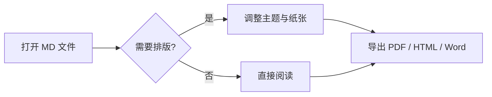
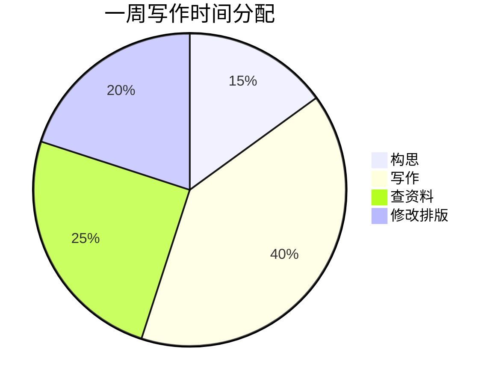

# MDeditor 功能演示

> 这是一份示例文档，用来快速体验 MDeditor 的全部能力。  
> 打开软件后点击侧栏中的本文件，配合顶部的 **主题** 和 **排版** 按钮体验效果。

## 基础排版

普通段落文本，支持 **加粗**、*斜体*、~~删除线~~、`行内代码`、[链接](https://example.com) 以及 ==高亮== 的文字（部分主题支持 mark 标记）。

不同主题下的标题风格不同，试试「仿 Word」「论文衬线」和「书卷衬线」。

### 三级标题

#### 四级标题

## 中文长文本（测试两端对齐与首行缩进）

Markdown 是一种轻量级标记语言，排版功能简洁，可读性高，广泛用于写作、笔记和技术文档。MDeditor 在标准 Markdown 之上增加了纸张排版、页边距、行距、首行缩进等 Word 与 PDF 式的细节控制，让纯文本写作也能输出正式文档般的阅读体验。你可以在「排版」面板中调整这些参数，所有更改都会实时反映在预览区，并在导出 PDF 时保持一致。

## 列表

### 无序列表

- 第一项
- 第二项
  - 嵌套项
  - 另一个嵌套项
- 第三项

### 任务列表（可直接点击勾选）

- [ ] 支持任务列表
- [ ] 完成毕业论文初稿
- [ ] 整理参考文献

### 有序列表

1. 打开文档
2. 编写内容
3. 选择主题并导出

## 表格

| 功能      | 说明                  |  状态 |
| ------- | ------------------- | :-: |
| 所见即所得预览 | 分栏实时渲染              |  ✅  |
| 多套主题    | 10 款内置 + 自定义        |  ✅  |
| 纸张排版    | A4/A5/B5/Letter/16K |  ✅  |
| 导出 PDF  | 通过系统打印              |  ✅  |

## 代码高亮

```python
def fib(n: int) -> int:
    """斐波那契数列"""
    a, b = 0, 1
    for _ in range(n):
        a, b = b, a + b
    return a

if __name__ == "__main__":
    print([fib(i) for i in range(10)])
```

```javascript
// 也可以是 JavaScript
const greeting = (name) => `你好，${name}！`;
console.log(greeting('Markdown'));
```

## 数学公式

行内公式：质能方程 $E = mc^2$，欧拉公式 $e^{i\pi} + 1 = 0$。

块级公式（高斯积分）：

$$
\int_{-\infty}^{\infty} e^{-x^2} \, dx = \sqrt{\pi}
$$

$$
\hat{f}(\xi) = \int_{-\infty}^{\infty} f(x)\, e^{-2\pi i x \xi} \, dx
$$

## Mermaid 图表





## 引用

> 简洁是智慧的灵魂。—— 莎士比亚
>
> 写作的本质是把思考留下来。

## 分隔线

---

以上。你可以现在就按 `Ctrl+P` 把这份文档导出成 PDF 看看效果。
